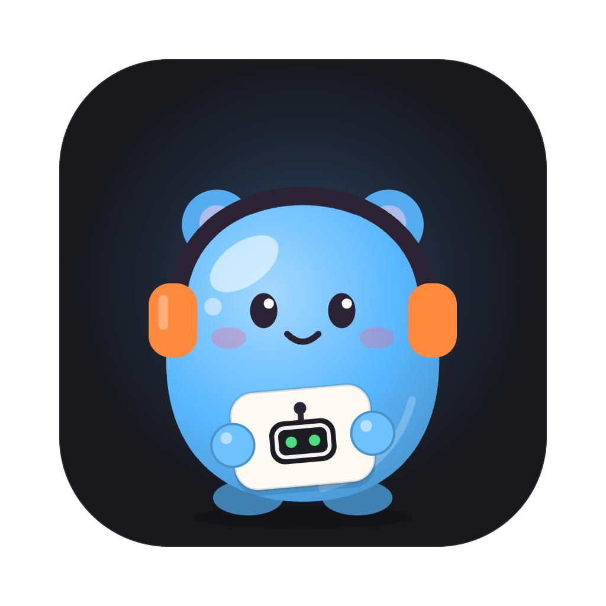
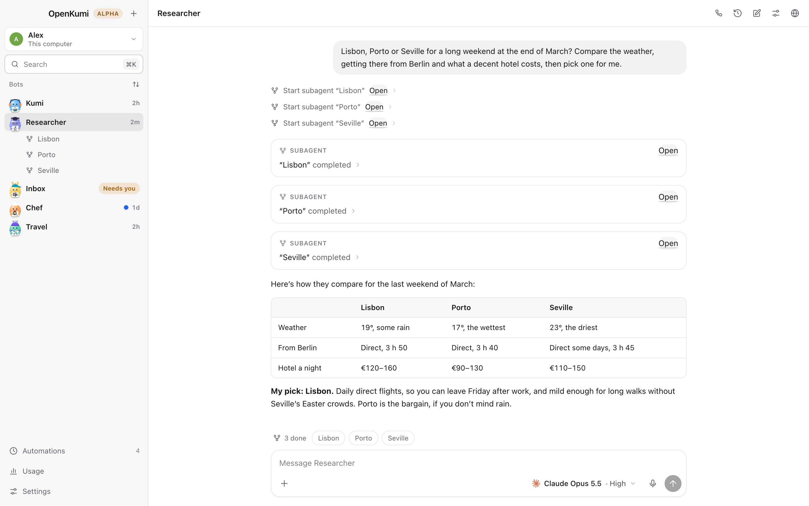
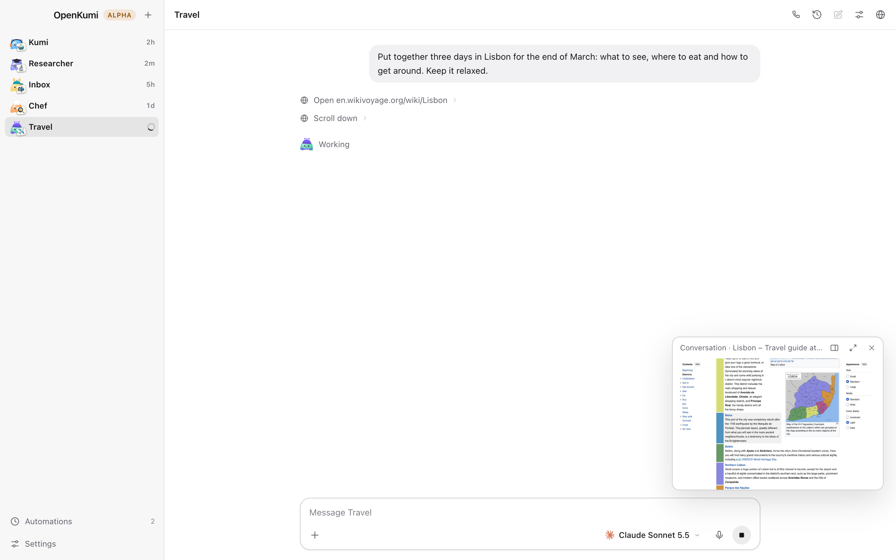
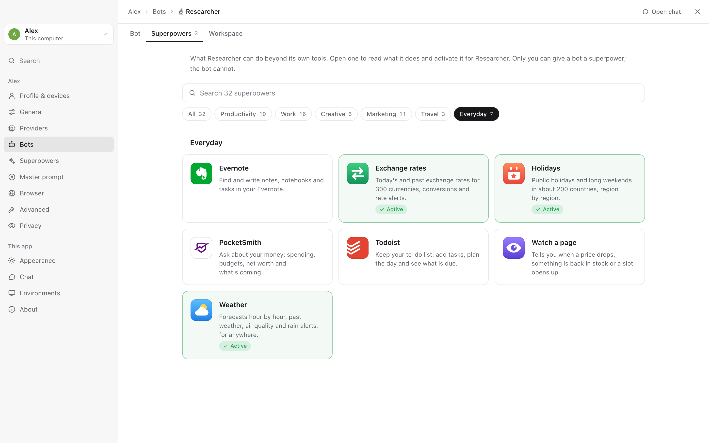
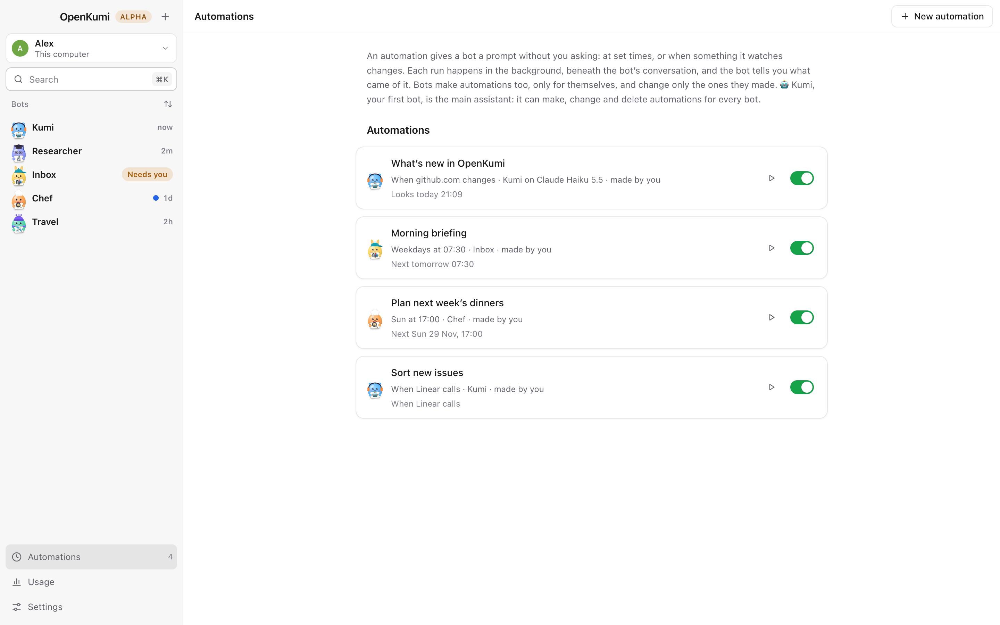
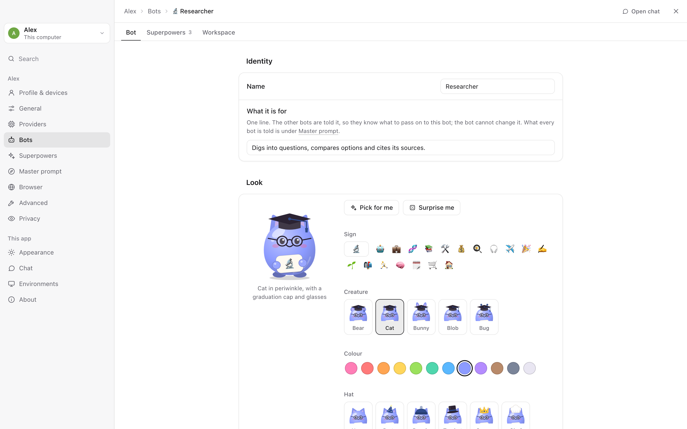

<p align="center">
  
</p>

<h1 align="center">OpenKumi</h1>

<p align="center">
  <b>Your own crew of AI bots.</b><br>
  A free, open-source desktop app for AI bots that live on your computer.
</p>

<p align="center">
  <a href="https://openkumi.ai">Website</a> ·
  <a href="#install">Install</a> ·
  <a href="#documentation">Documentation</a> ·
  <a href="https://github.com/jcmartinezdev/openkumi/releases/latest">Releases</a>
</p>

<picture>
  <source media="(prefers-color-scheme: dark)" srcset="apps/marketing/src/assets/screenshots/conversation-dark.png">
  
</picture>

## What it is

OpenKumi is a desktop app where you keep a small team of AI bots. Each bot is someone you talk
to, not a list of chats: it has one conversation, its own memory and files, and its own web
browser that stays signed in.

The bots run on your own computer, or on another computer of yours, using the Claude, ChatGPT or
Grok plan you already pay for, or a local model. There is no account to make and no API key to
buy, and nothing you say to a bot passes through a server of ours. The one thing OpenKumi asks to
send its makers is how it is used and where it breaks, never what you or your bots write, and
only if you agree: [all of it is listed](https://docs.openkumi.ai/telemetry/).

## What you get

- **Runs on what you already have.** Claude Code, Codex (your ChatGPT plan) or Grok: if the
  program is installed and signed in, OpenKumi uses it. Local models through Ollama or LM Studio
  work too, and so does any OpenAI-compatible endpoint.
- **One conversation per bot.** Whatever you say lands in the same place, and the bot can look up
  anything said in it, however long ago.
- **A browser for every bot.** Sign a bot in to a site once and it stays signed in. Watch it
  browse, take control when it needs you for a sign-in or a CAPTCHA, and hand back.
- **Subagents.** A bot splits a big job into parallel helpers and brings their results together.
- **Automations.** A bot does something every morning, when a web page changes, or when another
  app calls a webhook, and tells you what came of it.
- **Superpowers.** Switch on, for one bot at a time, what it can do beyond chatting and browsing:
  work in Notion, Linear, Jira, Todoist and some twenty other apps, or know-how such as the
  weather, exchange rates, SEO and launch plans.
- **Bots that learn how you work.** A bot keeps its own instructions and notes, and updates them.
  Every change is recorded, shown in the app, and can be undone.
- **Bots that work together.** A bot can pass work to another, or ask it for something. You read
  every such message.
- **Talk instead of typing.** Dictation is written down on the device itself (macOS 26 or later),
  so no sound leaves it.
- **Call your bot.** Talk with a bot out loud, from the computer or the iPhone, and it talks back
  at once. The voice comes with your ChatGPT plan, through Codex, with no API key; the work is
  still done by the bot itself, whatever it runs on. See [Calls](https://docs.openkumi.ai/calls/).
- **From your other computers and your phone.** Pair a laptop or an iPhone with a one-time code,
  at home directly and anywhere else over Tailscale.
- **Yours.** A bot is a folder of plain files on your disk that you can read, edit and back up.
  OpenKumi is MIT-licensed.

All of it, at more length: [What OpenKumi does](https://docs.openkumi.ai/features/).

<table>
  <tr>
    <td width="50%">
      <picture>
        <source media="(prefers-color-scheme: dark)" srcset="apps/marketing/src/assets/screenshots/browser-dark.png">
        
      </picture>
      <p align="center"><sub>A bot browsing, with its live view floating over the chat.</sub></p>
    </td>
    <td width="50%">
      <picture>
        <source media="(prefers-color-scheme: dark)" srcset="apps/marketing/src/assets/screenshots/superpowers-dark.png">
        
      </picture>
      <p align="center"><sub>Superpowers, switched on for one bot at a time.</sub></p>
    </td>
  </tr>
  <tr>
    <td width="50%">
      <picture>
        <source media="(prefers-color-scheme: dark)" srcset="apps/marketing/src/assets/screenshots/tasks-dark.png">
        
      </picture>
      <p align="center"><sub>Automations that run in the background and report back.</sub></p>
    </td>
    <td width="50%">
      <picture>
        <source media="(prefers-color-scheme: dark)" srcset="apps/marketing/src/assets/screenshots/bot-settings-dark.png">
        
      </picture>
      <p align="center"><sub>Every bot has a mascot. Choose its look, or let it pick.</sub></p>
    </td>
  </tr>
</table>

## Install

### The desktop app

Download the installer for your computer. The app brings everything it needs, including its own
server, and keeps itself up to date.

| Your computer | Download |
| --- | --- |
| Mac with Apple silicon (2020 and later) | [OpenKumi-mac-arm64.dmg](https://github.com/jcmartinezdev/openkumi/releases/latest/download/OpenKumi-mac-arm64.dmg) |
| Windows 10 or later | [OpenKumi-win-x64.exe](https://github.com/jcmartinezdev/openkumi/releases/latest/download/OpenKumi-win-x64.exe) |
| Linux, x64 | [OpenKumi-linux-x86_64.AppImage](https://github.com/jcmartinezdev/openkumi/releases/latest/download/OpenKumi-linux-x86_64.AppImage) |
| Linux, ARM | [OpenKumi-linux-arm64.AppImage](https://github.com/jcmartinezdev/openkumi/releases/latest/download/OpenKumi-linux-arm64.AppImage) |

- **Mac:** open the `.dmg` and drag OpenKumi to Applications. Macs with an Intel processor are
  not supported.
- **Windows:** run the installer. It is not signed yet, so Windows asks before running it: choose
  **More info**, then **Run anyway**.
- **Linux:** make the file runnable (`chmod +x OpenKumi-linux-*.AppImage`) and open it.

Every release is installed, opened and tried on Windows and Linux automatically, but nobody has
used OpenKumi there day to day yet. If something is off,
[tell us](https://github.com/jcmartinezdev/openkumi/issues).

### What the bots need

- **Google Chrome**, which the bots browse with.
- **Something to run on.** Any one of these is enough:
  - [Claude Code](https://claude.com/claude-code), signed in (`claude`)
  - Codex, signed in with your ChatGPT plan (`codex login`)
  - Grok Build, signed in (`grok login`)
  - [Ollama](https://ollama.com) or [LM Studio](https://lmstudio.ai), running
  - an OpenAI-compatible API, with its key
- **git**, optional: with it, every change a bot makes to its own files can be undone.

### First steps

1. Open OpenKumi. It asks where your bots should run: choose **Run them on this computer**.
2. Open **Settings → Providers** and check that at least one shows as connected.
3. Say hello to **Assistant**, the bot that comes with it, or make a bot of your own with **+**.

### On a computer with no screen

A Mac mini in a cupboard or a Linux machine can run your bots with no app in front of it. One
line installs OpenKumi there, with the Node it runs on, and keeps it running in the background:

```sh
curl -fsSL https://openkumi.ai/install.sh | sh
```

Then let your other computers in, and pair them:

```sh
openkumi status     # whether it runs, which version, what the bots can run on
openkumi lan on     # let your other computers and your phone reach it
openkumi pair       # a code to enter in the app: Settings → Environments → Add environment
```

`openkumi help` lists the rest (`update`, `logs`, `service`, `uninstall`). More in
[Installing and updating](https://docs.openkumi.ai/install/).

### From the source

With Node.js 22.18 or later:

```sh
git clone https://github.com/jcmartinezdev/openkumi.git
cd openkumi
npm install
npm start
```

## Updating

You do not have to do anything.

- **The desktop app** downloads a new version in the background and shows **Restart to update**
  when it is ready. It never restarts by itself, and asks first when bots are working.
- **OpenKumi on a computer with no screen** fetches a new version and starts it once no bot is
  working. `openkumi update` does it now, and **Settings → About** in a connected app can switch
  the automatic part off.

The app and a server do not have to be the same version. When one is too old for the other, the
app says which of the two to update.

## From another computer or your phone

Bots can run on one computer of yours while you talk to them from another, or from an iPhone.

1. On the computer that runs the bots: **Settings → Environments → Let other computers connect**,
   then **Pair a computer**. (With no app there: `openkumi lan on`, then `openkumi pair`.)
2. On the other computer: **Settings → Environments → Add environment**, and enter the address
   and the code it shows. On the phone, scan the QR code.

At home they connect directly. Away from home they connect over [Tailscale](https://tailscale.com)
when it is on for both. The iPhone app is a public beta on TestFlight:
[join it](https://testflight.apple.com/join/dvcBQvNu) from your iPhone. Its source is in `apps/mobile`. More in
[Other computers and your phone](https://docs.openkumi.ai/environments/).

## Documentation

The documentation is a site of its own, [docs.openkumi.ai](https://docs.openkumi.ai), made from the
Markdown files in `apps/docs/src/content/docs`.

| | |
| --- | --- |
| [Installing and updating](https://docs.openkumi.ai/install/) | the app, the server on a computer with no screen, and how both update |
| [Your first bot](https://docs.openkumi.ai/getting-started/) | from the first launch to a bot that works for you every morning |
| [What OpenKumi does](https://docs.openkumi.ai/features/) | every feature, at more length |
| [Setting up](https://docs.openkumi.ai/setup/providers/) | what bots run on, making a bot, other computers and the phone, superpowers, automations, webhooks, calls |
| [How it works](https://docs.openkumi.ai/how-it-works/) | the parts and how they talk, how a bot works, engines, tools, calls, with diagrams |
| [Security](https://docs.openkumi.ai/security/) | what is trusted and what is not, keys and pairing, what a bot can reach, what leaves your computer, known limits |
| [Reference](https://docs.openkumi.ai/settings/) | settings and environment variables, the `openkumi` command, troubleshooting |
| [Working on OpenKumi](docs/development.md) | running it from the source, the tests, and making a release |
| [Releasing the iPhone app](docs/mobile-releases.md) | how a release reaches the phones: over the air, or through TestFlight |

## Contributing

Issues and pull requests are welcome. To work on it:

```sh
npm run dev         # the app, with the interface reloading as you edit
npm test            # the tests of the server, of what the apps share, and of the desktop app
npm run typecheck
```

[Working on OpenKumi](docs/development.md) has the rest.

## Not built yet

Image attachments, running commands in a sandbox, superpowers with code of their own, Google
(Gmail, Calendar, Drive, Docs, Sheets, Slides) as superpowers, answering the confirmations a
service can ask for (MCP elicitation), and native Anthropic/Gemini providers.

## License

[MIT](LICENSE)
