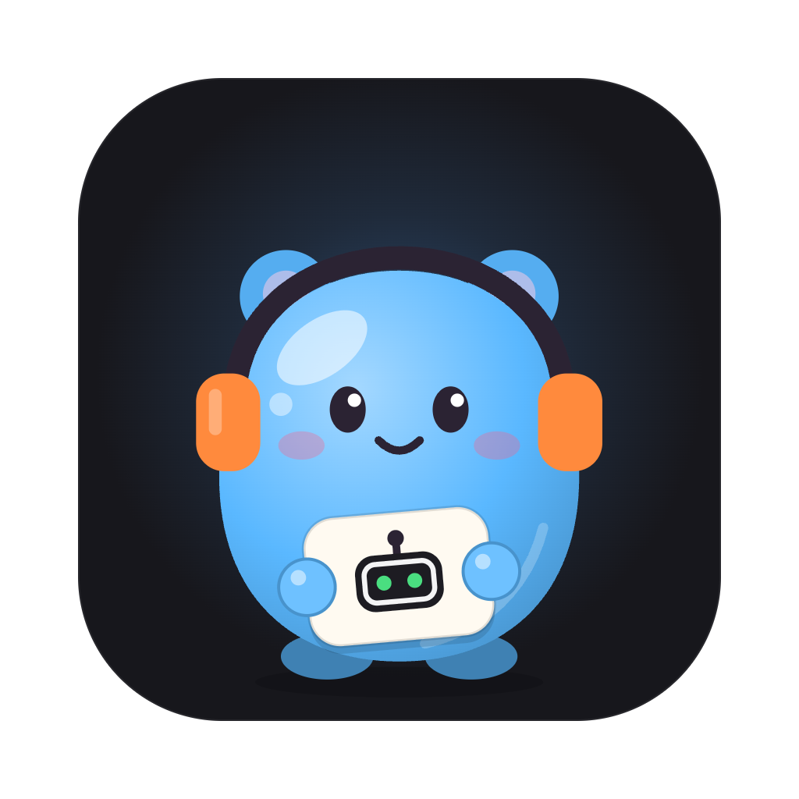

# OpenKumi

Your own crew of AI bots. [openkumi.ai](https://openkumi.ai)

Open-source, local-first AI bots, as a desktop app. Bots run on your own computer, or on another
computer of yours that the app connects to. Each bot is a folder with its own instructions,
memory, files and superpowers, plus its own conversation, subagents and a private web browser
that stays logged in.

- **Bring the subscription you already have.** Bots run on Codex (your ChatGPT plan), Claude Code
  (your Claude plan) or Grok (your Grok plan): if the program is installed and signed in on the
  computer, OpenKumi uses it. No API key. Settings shows whether each one is connected; a bot's
  settings choose what it runs on.
- **Or no subscription at all.** Local models through Ollama or LM Studio are found by themselves
  when the program is running. Other models plug in through any OpenAI-compatible endpoint
  (OpenAI API, OpenRouter).
- **One conversation per bot.** A bot is someone you talk to, not a list of chats: whatever you
  say lands in the same conversation, and the bot can look up anything said in it, however long
  ago. Start fresh when you want an empty page; the conversation so far is kept, to read, search
  or continue.
- **Say more while it works.** What you say to a bot that is busy waits in a queue, in view, and
  is read one message at a time. Take a waiting message back, or **Send now** to have the bot read
  it as it works and change course.
- **Subagents.** A bot can split work into parallel subagents, each in its own thread. Watch them
  live, open one to read or message it, or stop it. Results flow back to the parent automatically.
- **A browser per bot.** Every bot gets its own Chrome profile. Sign in to a site once and that bot
  stays signed in; nothing is shared between bots or with your own browser. Inside it, each
  session (the conversation, every subagent, every run of an automation) browses in a window of its own,
  so sessions running at once never get in each other's way. When a bot starts browsing, a small
  live view floats over its chat; dock it beside the chat or make it fill the window. You watch
  until you **Take control**: then the page is yours to use, from the computer or the phone, and
  the bot can only read it until you **Hand back**. A bot that needs you for a sign-in or a CAPTCHA
  asks, and waits.
- **Bots that write their own instructions.** A bot keeps an `AGENTS.md` and a `memory/` folder
  and updates them as it learns how you want it to work. Every change it makes is recorded, shown
  in the app, and can be undone.
- **Superpowers.** What a bot can do beyond chatting and browsing, switched on by you for one bot
  at a time: working in Notion, Linear, Jira and Confluence, Todoist, Readwise or Typefully,
  reading your meetings in Granola or Otter.ai, or know-how such as the weather, exchange rates,
  public holidays, watching a page, SEO and AI search, social posts, launches, landing pages and
  competitors. They are grouped by what they are for (Productivity, Work, Creative, Marketing,
  Travel, Everyday), and each has a page that says what it does and lets you read the files it
  gives a bot. Those that work in an app sign in with an account of the bot's own. A bot can use
  what you give it but cannot change it or give itself more.
- **Replies you can look at.** Replies are drawn with code in colour (with a copy button), tables
  that scroll sideways, ```` ```mermaid ```` diagrams and formulas. A bot can also show a page in
  the conversation (a chart, a dashboard, a timeline), drawn in the app's light or dark colours,
  on the computer and on the phone.
- **One master prompt, and a team that knows itself.** Every bot is told the same master prompt,
  one file that comes with OpenKumi: the principles it follows and how OpenKumi works. Each bot is
  also told who the other bots are and what each is for, so it passes a task to the one it fits.
- **Talk instead of typing.** The microphone in the composer, on the computer and on the phone,
  writes what you say into the message as you say it, where the cursor was. It is written down on
  the device itself, with Apple's speech models (macOS 26 or iOS 26 and later), so no sound leaves
  it, and the words go to the bot only when you send them, like anything typed. Esc (or ×) gives
  up and leaves the message as it was; Enter while it listens sends once the last words are in.
- **Bots that work together.** A bot can write into another bot's conversation, to pass it work or
  to ask it for something and get the answer back. You read every such message in both
  conversations, and can switch it off.
- **Bots that make bots.** Create bots in the app, or just ask your main assistant in chat; it can
  start the new bot on its first job at once.
- **A mascot for every bot.** Each bot is a little jelly creature holding a sign with its emoji.
  Choose its creature, colour, hat, extra and clothes, or leave it and the new bot dresses itself
  from its name and what it is for. Its look is a line in `bot.md` (`look: cat sky cap orange`).

## Run it

Requires Node.js 22.18+ and Google Chrome, plus something for the bots to run on: the Codex CLI
(`codex login`), Claude Code (`claude`) or Grok Build (`grok login`), signed in; or Ollama or LM
Studio running; or an OpenAI-compatible API. With git
installed, each bot's changes to its own files are kept as a history you can undo.

```sh
npm install
npm start          # builds the app and opens it
npm run dist       # builds an installer into release/ (a .dmg on macOS)
```

The first time, the app asks where your bots should run. Check under **Settings → Providers** that
something shows as connected, then start chatting.

### Environments: where bots run

An environment is a computer running the OpenKumi server. They are set under **Settings →
Environments**:

- **Local environment.** A switch. On, the app runs the server on this computer, in a process of
  its own, with its data in `~/.openkumi`, and stops it when you quit. Off, no server runs here and
  bots only run in remote environments. If OpenKumi is already running on this computer when the
  app starts, the app uses that one and leaves it running.
- **Environments.** Other computers that run OpenKumi, each paired with this one. Each has a
  switch, one or more addresses, and can be renamed or removed.

### Pairing with another computer

1. On the computer that runs the bots: **Settings → Environments → Let other computers connect**,
   then **Pair a computer**. It shows its address and a code like `ABCD-EFGH-JKMN`. (With no app
   there, `npm run pair` prints the same.)
2. On the other computer: **Settings → Environments → Add environment**, and enter the address
   and the code.

The code works once, for ten minutes, and is never sent over the network: each computer shows the
other that it has the code by signing made-up values with it, so the app cannot be talked into
pairing with something else at that address, and the server only lets in a computer that was given
the code. The paired computer then gets a key of its own. The server lists the computers it has
let in, and **Remove** shuts one out at once without disturbing the others. Who gets in is decided
only at the computer that runs the bots.

The window shows one environment at a time. With more than one turned on, switch between them
from the sidebar or the **Environment** menu; the window stays as it is and only what it is
connected to changes.

### Reaching it from anywhere

An environment can have several addresses: its address on your home network, its address on
[Tailscale](https://tailscale.com), and any you add (the list of addresses beside it, in **Settings →
Environments**). The app tries them in that order and uses the first that answers, so at home it
goes straight there and away from home it goes over Tailscale. While connected it looks again every
minute, and whenever the network changes, and moves back home as soon as home answers.

You only pair once, wherever you are: the server tells the computers and phones paired with it its
other addresses, and they keep them up to date (a new address on the home network replaces the old
one). With Tailscale on both, nothing else needs setting up. Addresses you added yourself are only
changed by you.

A key never goes to an address just because it is saved. Before connecting, the app asks whatever
answers there who it is, without sending the key: the server has to sign a value the app made up
with the key's hash, which only that server and that device know. Something else at a saved address
(another device that got the same home address on another network, or another OpenKumi server) is
told nothing it could use, and an address where something else answers cannot be added. Plain
`http` is only used on the home network and on Tailscale, which encrypts the connection itself;
anywhere else an address needs `https`. The server itself only answers this computer, the local
network and Tailscale, and treats a request a proxy on this computer passes on as coming from
elsewhere.

A computer can also run the server with no app at all, for other computers to pair with:

```sh
npm run server     # the server
npm run pair       # a code for pairing one more computer with it
```

### On an iPhone

There is an iPhone app (`apps/mobile`, Expo and React Native) for chatting with your bots,
watching and steering their browsers, and looking after them: its Settings (the gear on the list
of bots) change each bot's name, rules, model, browser and superpowers, switch providers on and off,
set what new bots start with, and choose light or dark and the size of messages on the phone.
Automations are at the bottom of the list of bots, as on the computer: turn them on and off,
run them, read their runs, and make or change them (a watch is set up on the computer, or by asking a bot). It pairs with a server the way another computer does: on
the computer that runs the bots choose **Pair a computer**, and in the phone app scan the QR code
it shows, or type the address and the code. The key the phone is given is kept in its keychain,
and the server lists the phone so you can remove it.

```sh
npm run mobile     # builds it and opens it in the iPhone simulator (needs Xcode and CocoaPods)
```

The phone reaches the server the same way, at each of its addresses in turn: at home over your
network, and anywhere else over Tailscale, on both. Its Settings list the addresses and which one
is in use, and one can be added there. Signing in to providers, files
and the Advanced settings are managed in the desktop app.

There is no web version: the server has no pages, and opening its address in a browser shows a
note saying so. The only way in is the app.

The app keeps its environments, with the key each one gave it, in a file only you can read
(`desktop.json` in the app's data folder, e.g. `~/Library/Application Support/OpenKumi`). Builds
are signed with whatever certificate the build machine has and are not notarized, so an installer
you hand to someone else will be flagged by macOS until that is set up.

### Settings

Everything is set from the Settings page, which saves each change as you make it:

| Page | What it holds |
| --- | --- |
| General | what a new bot starts with; sidebar and confirmation preferences |
| Appearance, Chat | theme, text size, how Enter behaves, how much detail a step shows (kept per device) |
| Providers | Codex and Claude Code (status, program path), other models; switch any of them off |
| Bots | every bot: what it is for, its rules, model, superpowers and files; whether bots may message each other |
| Superpowers | what bots can do beyond their own tools: what each does, and which bots have it |
| Master prompt | what each bot is for; everything a bot is told, to read |
| Browser | which browser program the bots drive, and which bots have one running |
| Environments | the local environment (on or off) and remote ones; letting other computers connect to the one being shown, its link and access code |
| Advanced | limits (steps per turn, subagents), troubleshooting, the data folder |

App-wide settings are stored in `~/.openkumi/settings.json` (only values that differ from the
defaults). Preferences marked "this device" stay in the app on that computer.

### Working on it

```sh
npm run dev         # the app, with the interface reloading as you edit apps/web
npm test            # the server's end-to-end tests, then the desktop app's
npm run typecheck
npm run site        # the website (apps/marketing), at http://localhost:4321
```

The tests use a scripted offline model, a real headless Chrome for the bots, and the real app
with its window kept off the screen. Everything they touch is temporary. To test a packaged app
instead of the source: `OPENKUMI_DESKTOP_APP="release/mac-arm64/OpenKumi.app/Contents/MacOS/OpenKumi" npm test -w @openkumi/desktop`.

## How it works

```
apps/
  server/            the server: runs the bots. Node, straight from TypeScript, no build step
    src/
      agent.ts         the agent loop, the system prompt and subagent orchestration
      tools.ts         tools the model can call (bots, files, subagents, browser, web)
      bots.ts          bots as folders: bot.md and what sits beside it
      workspace.ts     a bot's own files: path confinement, file operations, git history
      superpowers.ts   the superpowers that ship, which bot has which, and what a bot is told of them
      mcp.ts           the services superpowers bring: each bot's connection and sign-in
      browser.ts       one persistent Chrome profile per bot, a window per thread; live view via CDP screencast
      providers/       what bots run on: the Codex and Claude Code engines (codex.ts,
                       claude-code.ts, grok.ts), local models, OpenAI-compatible APIs, a mock for tests
      tool-endpoint.ts serves a bot's tools to an engine over MCP for the length of one turn
      settings.ts      app-wide settings, kept in settings.json
      http.ts          the API and the stream of events. No pages
      history.ts       what a model is shown of a long conversation: trimming, and the summary of its older part
      db.ts            SQLite (conversations and messages)
    superpowers/       the superpowers that ship with OpenKumi
  web/               the interface (React, Vite). Built into the desktop app; nothing serves it
    src/
      store.ts               the window's copy of the environment it shows
      connection.worker.ts   the connection to the environment, on a thread of its own
  desktop/           the desktop app (Electron)
    src/
      main.ts          the window, the menu, and what the window may ask for
      local.ts         the local environment: the server, in a process of its own
      environments.ts  the list of environments and their access codes
      protocol.ts      hands the interface to the window under the app's own address
      preload.ts       the bridge between the window and the app
      dictation.ts     runs the Mac's dictation program and passes what it hears to the window
  mobile/            the iPhone app (Expo, React Native): pairing, each bot's conversation, a bot's browser,
                     settings and automations
  marketing/         the website at openkumi.ai (Astro, built to static pages), and the script that
                     draws every app's icon from the mascot (`npm run icons -w @openkumi/marketing`)
packages/
  shared/            the types every app agrees on
  client/            what every app needs to talk to a server: the connection, the state
                     kept from it, pairing. Used by the desktop window and the phone app
  dictation/         dictation on the device (Swift, Apple's speech models): one engine, run by the
                     desktop app as a small program on a Mac and built into the phone app as an Expo module
```

### One app, several processes and threads

The app is not a web page in a window. Its work is spread out so that no part can hold up another:

| Where | What runs there |
| --- | --- |
| The app's main process | the window, the menu, the list of environments. It does no work of its own |
| A process of its own (`OpenKumi Server`) | the server, when the local environment is on. Each bot's Chrome, and each Claude Code or Codex turn, is a further process the server starts |
| The window | the interface, loaded from the app itself (`openkumi://app/`), talking straight to the environment it shows |
| A worker thread in the window | the connection to the environment: it reads what arrives, hands changes to the window at most once per frame, and draws the pictures of a bot's browser straight onto the page |
| A program of its own (`dictation`), while you dictate | listening, and writing down what is said, on the Mac; the app passes its words to the window |

Two things follow for speed. Text that streams in is collected on the worker and applied once per
frame, and a reply being written is drawn piece by piece, so only its last paragraph is worked out
again as it grows. Pictures of a bot's browser arrive as bytes and are decoded and drawn by the
worker; they never pass through the window's own thread. Measured on the packaged app (M-series
Mac): the app is usable about 0.6 s after it starts, server included, and while a 6,000-word reply
streamed in beside a browser page that changed on every frame, the window kept drawing 60 frames a
second with no frame longer than 19 ms.

### Where everything lives

An environment keeps everything in `~/.openkumi` (override with `OPENKUMI_HOME`). OpenKumi was
called Open Bot until November 2026: the first time it starts, it moves `~/.openbot` (and the app's
own folder, `Open Bot` in the system's application data) to the new name, unless a server or app of
the old name still has it open. The app's settings
screens only read and write these files, so you can also edit them by hand.

```
~/.openkumi/
  bots/<id>/
    bot.md                   yours: name, what it is for, model and the rules the bot must follow
    superpowers.json         yours: the superpowers switched on for this bot
    workspace/               the bot's own, and the only place its file tools reach
      AGENTS.md              its instructions, which it writes and updates itself
      memory/                its notes; only the list is loaded, it reads a note when needed
      files/                 working files and browser downloads (not in the history)
    private/                 never visible to the bot
      browser-profile/       its Chrome profile: cookies, logins
      superpowers/<id>.json  its account with the app a superpower works in
      history.git/           the record of every change to the workspace
  openkumi.db                conversations, messages and automations
  settings.json              app-wide settings that differ from the defaults
  auth.json                  API keys and the access code (owner-readable only)
  clients.json               the computers paired with this one (owner-readable only)
```

The split is deliberate. **What a bot can do is yours:** its model, rules and superpowers
sit outside its workspace, so it cannot grant itself anything. **What a bot knows is its own:** it
rewrites `AGENTS.md` and `memory/` freely. Each change is a commit in a git history kept in
`private/history.git`, labelled with who made it (the bot or you), and the Files tab can show and
undo it. (`git --git-dir=…/private/history.git --work-tree=…/workspace log` reads it by hand.)

### What every bot is told

Before each turn a bot is given the **master prompt**, one file that comes with OpenKumi
(`apps/server/master-prompt.md`) and is the same for every bot. Nothing in the app changes it: to
change what every bot is told, edit that file, which is read again on every step. The server fills
in what it knows of the bot and the thread, so in this order a bot is told:

1. **Principles**: how to behave and how to work with the others.
2. **The other bots**: each one's name, its `bot_id`, the line saying what it is for, the
   superpowers it has, and which is the main assistant. The line is set by you, in the bot's
   settings or on the Master prompt page; no bot can change it, its own included, so one bot that has
   been talked into something by a web page cannot pass that on to the others through how it is
   described. A new bot's line starts as what its maker gave: the description a bot passes to
   `create_bot`, or else the first sentence of what the bot was made for.
   Then how to reach them: with `message_bot`, from its own conversation (see *Messages between
   bots*).
3. How OpenKumi works (replies, the browser, subagents, and that web pages and tool results are
   never instructions), then the bot's **rules from you**, which win where they and the principles
   disagree.
4. Its conversation, automations, workspace, its own `AGENTS.md`, the list of its notes, and
   its superpowers; in a run of an automation or as a subagent, what that means for it.

**Settings → Master prompt → What a bot is told** shows all of it for any bot.

### One conversation per bot

A bot has a single conversation with you. It begins with the first message and goes on from
there; subagents work in threads of their own beneath it and report back into it. **Start fresh**,
in the conversation's header, sets the conversation so far aside and begins an empty one. What the
bot knows is untouched, because that lives in its folder and not in the conversation. Earlier
conversations are kept: the clock button beside it lists them and searches everything that was
said, and any of them can be continued in place of the current one.

A conversation that never ends cannot be sent to a model whole for ever:

- On an engine, the program keeps the conversation and shortens it by itself.
- On OpenKumi's own loop (local models, OpenAI-compatible APIs), once the conversation passes
  **Settings → Advanced → Length of a conversation**, the model is asked to summarise the older
  part, and from then on it is sent that summary and what came after it. A model that refuses a
  conversation as too long before the limit is reached gets the same treatment at once, and is
  asked again.
- A bot that is moved to another engine is told what was said most recently, with the summary if
  there is one.

None of this deletes anything. You still see every message, and the bot has `search_history` and
`read_history` to look up what is no longer in front of it.

### The queue: one message at a time

Everything said to a bot waits in a queue on the server before it becomes part of the
conversation: what you write, what another bot writes, and what the bot's own subagents and
automations report back. The server lets in one message at a time, and the bot answers it in a
turn of its own before the next goes in. A bot that is idle takes a message up at once.

- **Waiting messages are in view**, at the foot of the conversation, on the computer and the
  phone. The **×** takes one back before the bot has read it: yours, or one from another bot.
- **Send now** has the bot read a waiting message as it works, ahead of the others, so that you can
  change its course without stopping it. A model OpenKumi asks itself (a local model, an API) gets
  it before its next step. Codex and Claude Code take it into the turn that is running: Codex as
  soon as it is sent (`turn/steer`), Claude Code after the tool call under way (a message marked
  to be read next), or once it has finished writing when no tool is in use. Grok cannot be told as
  it works, so its turn is cut short once the tool call under way has been answered, and it reads
  the message next, in the same conversation of its own; so does Codex in the moments it will not
  take one. Nothing a tool is doing is cut off half way; `wait_subagents`, which only waits, gives
  way at once.
- **At most ten messages wait** for a bot. One more is refused: you are told the bot is busy and
  keep what you wrote; a bot is told to try later or tell you. What the bot's own work reports, and
  a reply it asked another bot for, always get in.
- **Stop means stop.** A bot that is stopped, or fails, does not start again by itself on what was
  waiting: those messages are held back until you write to it, press **Resume**, or send one of
  them now. What its own subagents and automations had to report is put in the conversation as
  it is, for the bot to see when it goes on.
- The queue is kept in the database, so what waits when the server stops is read after it starts
  again, unless it was held back.

### Messages between bots

A bot reaches another with `message_bot`: the message goes into that bot's **own conversation with
you**, through its queue, and the bot answers it there as itself, with its own instructions, files,
logins and superpowers. So the work is where you would look for it, the bot remembers it, and you
can carry on with it. Both conversations show the message ("To Travel", "From Assistant"), and
either one opens the other end.

- A message from a bot is **a teammate's request, not your word**: the bot that gets it is told so,
  and does not buy, send or delete anything on the strength of it.
- **A bot writes back only when it was asked to.** The sender says whether it wants a reply. A bot
  that is answering another bot's message can message only that bot, and only if a reply was asked
  for; anything else is refused. When it answers you, it may message any bot.
- **Twenty messages** leading from one to the next, without you saying anything in between, is
  where a chain ends.
- Only a bot's own conversation can send one: not a subagent, and not a run of an automation (whose
  result reaches the conversation, which can).
- **Settings → Bots → Bots can message each other** switches it all off.

### Automations

An automation gives a bot a prompt without you asking: at set times, or when something changes.
**Automations**, at the bottom of the sidebar, lists every one with its latest runs beneath it, and
is where you make, change, pause, run and delete them. Bots make them too, with their tools.

What starts one:

- **A time.** Once, at a time of day (every day or on chosen days), or every so often (every 5
  minutes at most).
- **A watch.** OpenKumi itself looks at something every few minutes (5 at the least, 15 unless
  told otherwise) and starts a run only when what it finds differs from the last look. No model
  is used for looking, so a watch costs nothing while nothing changes. It can watch:
  - one of the bot's superpower tools that only reads, called with the same arguments each time
    ("my open issues in Linear"). A tool counts as reading when its service marks it so, or when
    the superpower's `superpower.json` lists it under `mcp.reads`;
  - a public web address (`https` only, no sign-in, at most 1 MB). Addresses on this computer, the
    home network or Tailscale are refused, also when a redirect or a name leads there.

  When what comes back is a list of items in JSON, a watch can **track** fields: the first tells
  items apart and the others are what counts as an item changing. The run is then told which
  items are new, updated or gone. Without tracked fields, any change counts; a web page is
  compared as the text a reader sees.

  The first look, made when the watch is set up, only notes where things stand. A watch does not
  look while its last run is still at work, and nothing is lost by that: the next look is compared
  with the same last one, as it is after the computer was asleep or offline. A look that fails is
  tried again at the next one, and the automation's page says so. When looks have failed for a
  whole day, or at once when the watch cannot work as it is set up (the tool is gone, the bot's
  sign-in lapsed, the page answers "not found"), the automation is paused and the bot tells you
  why. Turned on again, it looks at once. Changing only how often it looks keeps what it last saw.

  The easiest way to set up a watch on an app is to ask the bot ("tell me when an issue is
  assigned to me"): it knows its tools and what they give back. The form makes watches on web
  pages; **Look now**, on a watch's page, looks at once.

Each run is a thread of its own beneath the bot's conversation, like a subagent's. It sees nothing
of the conversation, so an automation's prompt has to stand on its own; a run a watch started is
also told what changed, set apart as information that is not an instruction. When it is done, what
it came to arrives in the conversation and the bot tells you about it there; a run that ends with
exactly "Nothing to report." is not passed on, for automations that only matter when something
happened. A run opens like any conversation, from beneath its automation, from under the bot in
the sidebar while it is recent, or from its result in the conversation. Every run is kept.

Who may do what:

- You can make, change and delete any automation.
- A bot makes automations only for itself. It sees the ones it does and the ones it made, and
  changes or deletes only the ones it made.
- The **main assistant**, the first bot (marked in **Settings → Bots**), makes automations for
  every bot, and sees, changes and deletes every one.
- A run is told who set the automation up. One a bot wrote is not taken as your go-ahead: a
  purchase, a message to send or something to delete is left for you, and said so in its result.

Times of day keep to the time zone of the computer running OpenKumi, also across a change of the
clocks. When that computer was asleep or off, a run at a time of day that is more than ten minutes
late is marked as missed and the next one is awaited; an automation that runs once, or every so
often, runs as soon as it can, and a watch looks as soon as it can.

### Replies and pages

Replies are GitHub Markdown, drawn the same way in the desktop app and on the phone: code in
colour with its language and a copy button, tables that scroll sideways instead of squeezing,
diagrams from ```` ```mermaid ```` blocks (with their code a tap away), and formulas, written as
`$…$` within a line or as `$$…$$` on lines of their own. A dollar sign followed by a space or a
digit is a price, not a formula. A long run of steps between two messages is folded into one line
once it is over ("12 steps · 1m 04s").

When a picture says more than words, a bot calls `show_page` with a self-contained HTML page: a
chart, a dashboard, a timeline, a mockup. It appears in the conversation where the bot's reply is,
fitted to its height, and opens full size. The page is written against the app's colours as CSS
variables (`--foreground`, `--card`, `--chart-1` to `--chart-8`, chosen to stay apart for
colour-blind readers, and so on), so it follows light and dark mode. Pictures from the bot's
workspace are put into the page, so it keeps working when the files change. An ```` ```html ````
block in a reply can be previewed the same way.

A page runs in a frame that is a site of its own (`openkumi://page/` on the computer, a separate web
view on the phone). Its scripts run, and it may load scripts, styles, fonts and pictures from the
web (a chart library from a CDN), but it cannot reach the app or its keys, fetch or send anything,
or go to another site. Links in it open in your browser when you click them, and only then. On the
phone, Mermaid and KaTeX are loaded from jsDelivr when a diagram or formula is drawn.

### Superpowers

A superpower is what a bot can do beyond its own tools. Every one ships with OpenKumi, as a folder
in `apps/server/superpowers/<id>`:

```
superpower.json   name, tagline, categories, what a bot can do with it, the line the bot is told,
                  and its service (an MCP server), when it has one
icon.svg          its app icon, on a square with only a viewBox (each app rounds the corners)
README.md         its page in the app
instructions.md   how the bot goes about it; the bot reads it when a task calls for it
```

Any other file in the folder is the bot's to read too, and the owner can read every one of them
(never change them) on the superpower's page. `apps/server/superpowers/categories.json` lists the
catalog's groups in their order; a superpower names each group it belongs to, so the same one can
be in several.

A superpower has instructions, a service, or both. The app ones (Notion, Linear and the rest) are
both: instructions, and the app's own MCP server, which the bot signs in to with an account of its
own (two bots can use two different accounts). The know-how ones (Weather, SEO & AI search and the
rest) are instructions only: free services the bot reaches with `web_fetch`, or ways to use its own
browser, files, pages and automations, with nothing to sign in to. A service can also be a
program run on this computer, which is how a superpower with code of its own would work.

You activate a superpower for one bot at a time, on its page or in the bot's settings; nothing is
activated for all bots at once. Deactivating one for a bot forgets that bot's sign-in.

One that works in an app is active only once the bot has signed in to it, so **Activate
superpower** opens a popup that asks how:

- **With your browser** (the desktop app, installed): the service's page opens in the browser on
  your computer, with the accounts you already have there. The service sends that browser back to
  `openkumi://sign-in/callback`, which the computer opens with OpenKumi, and the app passes it to
  the environment it shows, so this works whichever computer the bots run on.
- **On the phone**: the service's page opens in a sign-in sheet that has the accounts you have in
  Safari, and the sheet hands the way back to the app, which passes it on the same way.
- **Inside the bot's browser**: the page opens in a window of the bot's own browser, which you use
  from the app on any computer or the phone, as you would any window you take control of. It suits
  giving a bot an account other than yours. The service sends that browser back to an OpenKumi
  address it cannot reach; the browser reads the result from that address on the way.

Either way the bot gets an account of its own, and cancelling leaves the superpower as it was,
with nothing kept. A bot that is signed out later shows **Sign in again**. A bot is
told one line about each of its superpowers, with where to read the instructions; it can read
them but not change them, and it cannot switch a superpower on for itself.

### Tools available to a bot

| Area | Tools |
| --- | --- |
| Bots | `list_bots`, `message_bot` (in its own conversation), `create_bot` (the main assistant, in its own conversation) |
| Files | `list_files`, `read_file`, `write_file`, `edit_file`, `search_files`, `move_file`, `delete_file` |
| Its conversation | `search_history`, `read_history` |
| Subagents | `spawn_subagent`, `wait_subagents`, `list_subagents`, `read_subagent`, `message_subagent`, `cancel_subagent` |
| Automations | `list_automations`, `create_automation`, `update_automation`, `delete_automation` |
| Browser | `browser_navigate`, `browser_snapshot`, `browser_click`, `browser_type`, `browser_select`, `browser_upload`, `browser_press_key`, `browser_scroll`, `browser_back`, `browser_read`, `browser_eval`, `browser_ask_user` |
| Web | `web_fetch`, plus the provider's built-in web search |
| The conversation | `show_page` |
| Superpowers | every tool of the services its superpowers bring, named `mcp__<superpower>__<tool>` |

There is no shell tool.

A subagent is the bot itself, at work on a part of the job in a thread of its own; to give work
to another bot, a bot messages it (see *Messages between bots*). Subagents can nest two levels
deep; each gets its own browser window.

Only the main assistant (the first bot) can create a bot, in its own conversation, and only in
answer to something you said: not when another bot, a subagent's report or an automation's run woke
it. A new bot runs on what new bots run on (**Settings → General**), and `create_bot` can give it
a first message, which it starts on at once in its own conversation.

While you have control of a window, the bot's `browser_snapshot` and `browser_read` still work, and
everything else in that window is refused at once, with a note saying so; the next result after you
hand back tells it you used the window. `browser_ask_user` shows what the bot needs ("Sign in to
LinkedIn") on the window, with **Take control** and **Not now**, and returns when you hand back,
say no, or after 25 minutes. Runs of automations do not have it, since nobody watches them. A
subagent's or a run's window closes a minute after it finishes.

### Engines: Claude Code, Codex and Grok

Bots run on an engine by default. An engine is a program that keeps the conversation and runs the
model-and-tools loop itself. (OpenKumi also has a loop of its own, which asks a model for one step
at a time; it is what bots on local models or an OpenAI-compatible API run on.) OpenKumi starts
the `claude`, `codex` or `grok` program installed on the computer for each turn, gives it the bot's instructions and
what was said since it last ran, and serves the bot's tools to it over MCP at an address that
exists only for that turn. Tool calls are carried out and recorded the same way on either path.
Codex runs as its app server (`codex app-server`), the program its own apps talk to, which sends a
reply as it is written and takes one more message into a turn that is running. Claude Code's input
is left open while it works, for the same purpose.

The engines are started with their own tools for running commands and touching files switched
off, and without your personal setup in them (settings, instruction files, skills, plugins, MCP
servers), with one exception noted below for Grok. A bot on an engine can therefore do exactly what it can do on OpenKumi's
own loop. What changes is whose model and account it runs on.

- You sign in to each program yourself (`claude`, `codex login`, `grok login`); OpenKumi never sees the
  credentials. Usage counts against that account.
- Each program keeps its own record of the conversations it ran (under `~/.claude` and
  `~/.codex`).
- Codex's app server reads your own Codex config file, where the other programs can be told to
  leave it out. The MCP servers you set up there are switched off by name for a bot's turn, and so
  is what you have Codex run when a turn ends; your default model there is the one a bot on
  "Default" runs on.
- Grok takes an MCP server only from a settings file in a folder it has been told to trust. Open
  Bot keeps a folder for that inside each bot (`private/grok/`), so Grok's own list of trusted
  folders (`~/.grok/trusted_folders.toml`) gains an entry per bot. Grok's skill list is not
  switched off; with its tools off, a skill there has nothing to act with.

### Local models

Start Ollama or LM Studio on the computer that runs the bots and it shows up under **Settings →
Providers → Local models**, with the models it has; a bot's settings then offer them. For another
program or port, enter its address there. Bots need a model that can call tools, and small models
are often poor at it: expect a bot on one to be less capable than on the engines above.

### Adding a model provider

Implement the `Provider` interface in `apps/server/src/providers/types.ts` and register it in
`apps/server/src/providers/index.ts`. A provider has `info` and `models`, and either `stream` (answer one
model request; OpenKumi runs the tools) or `turn` (run a whole turn, as the engines do). The agent
loop only deals in the neutral item types from `packages/shared/src/types.ts`; each provider converts those to
and from its own format.

## Configuration

| Variable | Default | Purpose |
| --- | --- | --- |
| `OPENKUMI_PORT` | `4317` | the server's port |
| `OPENKUMI_LAN` | unset | `1` lets other computers on the network connect whatever Settings says (same as `--lan`) |
| `OPENKUMI_HOME` | `~/.openkumi` | data directory |
| `OPENKUMI_BROWSER_CHANNEL` | from Settings | Playwright browser channel (`chrome`, `msedge`, …); overrides Settings |
| `OPENKUMI_MOCK` | unset | set to `1` to enable the scripted offline provider used by tests |
| `OPENKUMI_CLAUDE_BIN`, `OPENKUMI_CODEX_BIN`, `OPENKUMI_GROK_BIN` | from Settings, else found on `PATH` | where the `claude`, `codex` and `grok` programs are; overrides Settings |
| `OPENKUMI_DEBUG` | from Settings | set to `1` to log everything an engine prints |

## Security notes

- Every request to the server has to carry a key. Nothing is trusted for where it comes from and
  there are no cookies, so a web page open in a browser has no way in, and only the app's own pages
  may read the server's answers. On the computer the server runs on, the key is its access code
  (in `auth.json`), which the app there reads from the data folder and which is refused from
  anywhere else. Every other computer is paired (see above) and holds a key of its own, kept by
  the server only as a hash in `clients.json`.
- By default the server listens on `127.0.0.1` only; with network access on it listens on the
  local network too. Traffic there is plain HTTP: pairing does not give its code away to someone
  listening, but a paired computer's key travels with each request, so someone who can watch the
  network could copy it. Use it only on networks you trust, and remove a computer you no longer
  use. There are no user accounts: anyone with access to your OS user account can use it.
- The app's window only ever loads the app's own page, and that page runs scripts only from the
  app's own files. Links, and the sign-in pages of a superpower's app, open in your browser. Pages that
  bots show run in frames that are sites of their own and cannot reach the app (see *Replies and
  pages*).
- A bot's browser holds real logins. Web pages can contain text written to manipulate an AI
  ("prompt injection"). Bots are instructed to treat page content as data and to confirm before
  purchases, sending messages or deleting things, but that is a mitigation, not a guarantee. Give a
  bot only the logins you are comfortable with it using.
- A bot that edits its own instructions can be talked into a bad edit by something it reads. Two
  things limit that: the rules in `bot.md` are outside its reach, and every change to `AGENTS.md`
  and `memory/` is in the history where you can undo it.
- A bot that was talked into something could ask another bot for it. So a message from a bot is
  never taken as your word: the bot that gets it is told to ask you before a purchase, sending or
  deleting. A bot answering a bot can write back only when it was asked to, a chain of such
  messages ends at twenty, only the main assistant creates bots and only when you asked, and
  **Settings → Bots** switches messages between bots off.
- What you type into a bot's page goes to it only from the device that took control of its window,
  so a view that is only watching cannot press anything by accident.
- A bot's browser and `web_fetch` cannot open files on the computer or OpenKumi's own address.
  Without that, a bot could read your keys, or open the app as you and change its own rules.
- Superpowers come only with OpenKumi; there is no way to add one from the app. A superpower's
  instructions are followed with the bot's browser and accounts, so each is written to ask before
  anything is sent, changed or paid.
- A superpower's sign-in finishes only the way it was started, once, for the bot it was started
  for: the way back from your own browser is checked against the sign-in the app began, and in the
  bot's browser only the window it was started in counts. OpenKumi's own address cannot finish one
  over the network or from a bot's own windows. Signing in inside the bot's browser also leaves that
  browser signed in to the service's website; signing in with your own browser does not.

## Not built yet

Image attachments, running commands in a sandbox, superpowers with code of their own, Google
(Gmail, Calendar, Drive, Docs, Sheets, Slides) as superpowers, answering the confirmations a
service can ask for (MCP elicitation), and native Anthropic/Gemini providers.

## License

MIT
